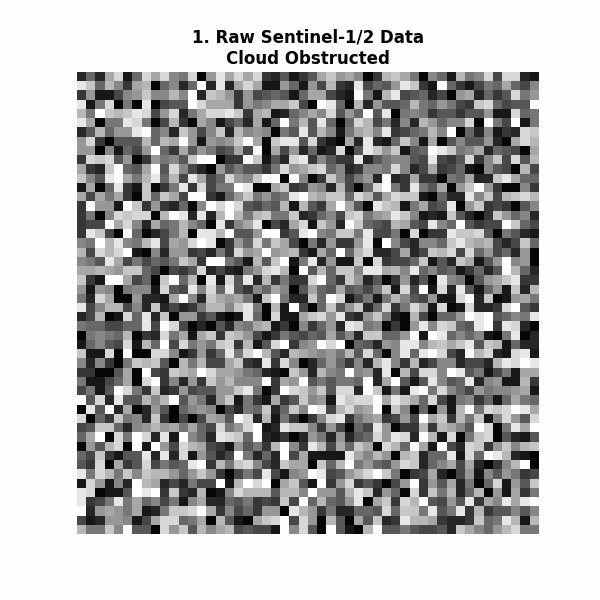

# 🌲 Ireland Forest Carbon Monitoring Pipeline
**A Sentinel-1/2 Hybrid Approach for EU LULUCF Compliance.**  
*Built for cloud-proof, species-specific, and reproducible carbon accounting.*

## 🚀 Quick Start
1. **Setup Environment:** `conda env create -f environment.yaml`
2. **Activate:** `conda activate ireland-forest-carbon`
3. **Run Pipeline:** Open `notebooks/99_Master_Orchestrator.ipynb` and click "Run All".

## 🏗️ Architecture
- **`src/`**: Core modular Python logic (The Engine)
- **`notebooks/`**: Interactive Colab Wrappers with Smart Uploads & Previews
- **`configs/`**: Region-specific YAML (Ireland, UK, Scandinavia)
- **`docs/`**: "Code as Documentation" & Pipeline GIF Generator

## 📊 Pipeline Phases
1. **CRS Reprojection:** WGS84 $\rightarrow$ ETRS89/UTM 29N (EPSG:25829)
2. **Cloud-Proof Masking:** Sentinel-1 VH/VV radar fusion.
3. **NFI Integration:** Relascope/Laser Hypsometer math ($H = D \times \tan(\theta) + h$).
4. **ML Classification:** U-Net (Dice+BCE Loss) for Sitka Spruce, Lodgepole Pine, Native Mixed.
5. **Carbon Accounting:** Species $\times$ Age Matrix with $\pm 95\%$ CI uncertainty.
6. **Density & LULC Layers:** VDF, MDF, Open Forest, Nurseries, Barren Land mapping.

---
*Built by Syed Rafi Ahmed | M.Tech Remote Sensing & GIS*
